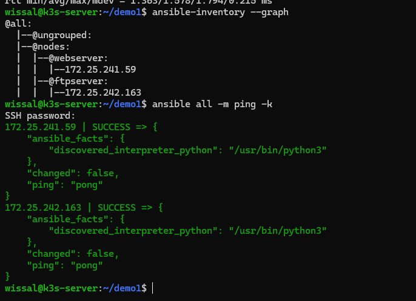
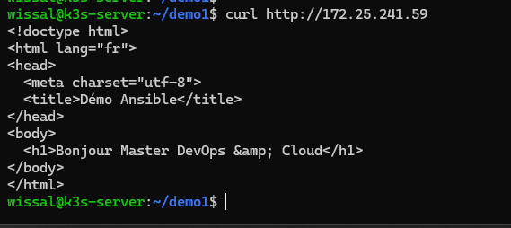
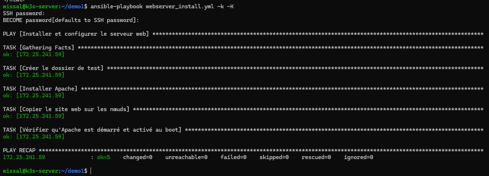
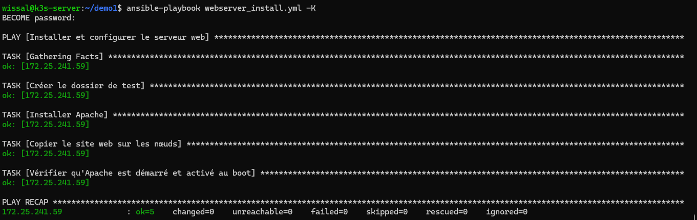
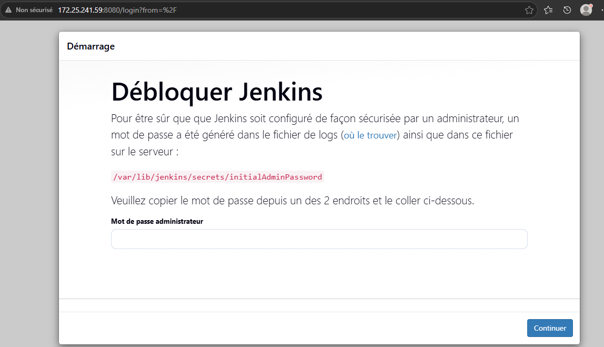
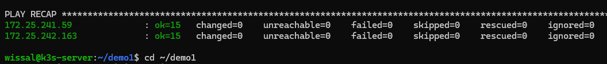

# TP4 : Bases d'Ansible (inventaire, playbooks, clés SSH, rôles)

Master DevOps & Cloud. Réalisé par Wissal El Kouk.

## Environnement
- 3 VM Ubuntu Server sous Hyper-V (même commutateur virtuel)
- `k3s-server` : nœud de contrôle Ansible
- `k3s-agent1` (groupe `webserver`) et `k3s-agent2` (groupe `ftpserver`) : nœuds gérés

## Avancement
| Partie | Contenu | État |
|---|---|---|
| 0 | Environnement, inventaire, ping | Fait |
| 1 | `ansible.cfg` | Fait |
| 2 | Playbook `webserver_install.yml`, idempotence | Fait |
| 3 | Authentification SSH par clé | Fait |
| 4 | Docker, Jenkins, Portainer, conteneur (`docker_stack.yml`) | Fait |
| 5 | Rôles (`site.yml`) | Fait |

## Contenu du dépôt
- `inventory.txt`, `ansible.cfg`, `group_vars/all.yml`
- `webserver_install.yml` : installation d'Apache et déploiement de `index.html`
- `Dockerfile`, `docker-compose.yml` : image du site web
- `docker_stack.yml` : Jenkins, Docker, Portainer, conteneur web (partie 4)
- `site.yml` et `roles/` : même playbook avec des rôles (partie 5)

## Exécution
```bash
sudo apt install -y ansible sshpass
ansible-galaxy collection install -r requirements.yml
ansible all -m ping -k
ansible-playbook webserver_install.yml -k -K
```

## Captures

### Ping / pong sur les 2 nœuds


### Premier passage du playbook + curl


### Idempotence (changed=0)


### Connexion SSH par clé (sans -k)


### Jenkins, Portainer et conteneur web accessibles


### Playbook à base de rôles (changed=0)

